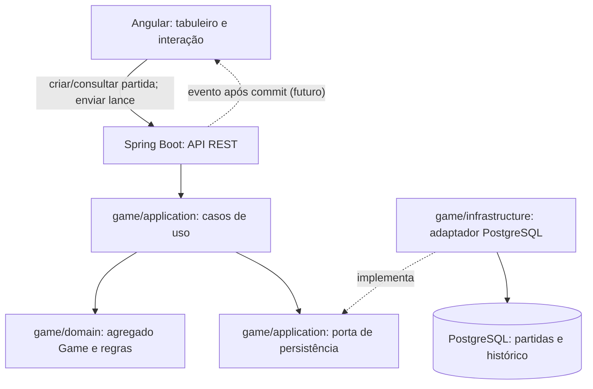

# Arquitetura da aplicação (planejada)

Este diagrama mostra os limites dos componentes. Hoje apenas o modelo inicial de domínio existe no backend; API, persistência, Angular e WebSocket serão implementados por etapas.

## Responsabilidades

- O agregado `Game` decide se o lance completo é válido, atualiza o tabuleiro e troca a vez. As regras brasileiras de 64 casas estão em [regras](../rules/README.md).
- O caso de uso identifica o jogador autenticado, carrega a partida, invoca o domínio e persiste o resultado. `expectedVersion` detecta comandos criados sobre um estado antigo.
- O adaptador de persistência executa a atualização condicional de versão e registra o lance na mesma transação. O banco é a fonte oficial.
- A API traduz comandos e erros em respostas; Angular renderiza o estado recebido. WebSocket será acrescentado quando houver dois clientes simultâneos.

O pacote `game` agrupa a funcionalidade; suas camadas `domain`, `application` e `infrastructure` serão preenchidas conforme cada etapa for implementada. `Player` é outro agregado e `Game` guarda seus identificadores.
