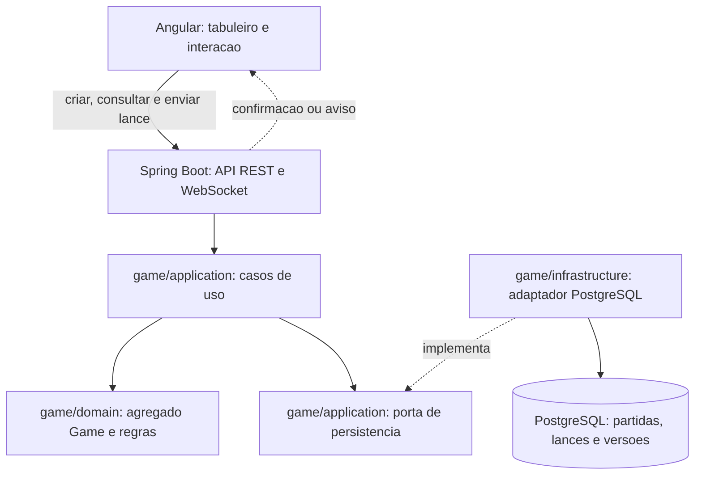
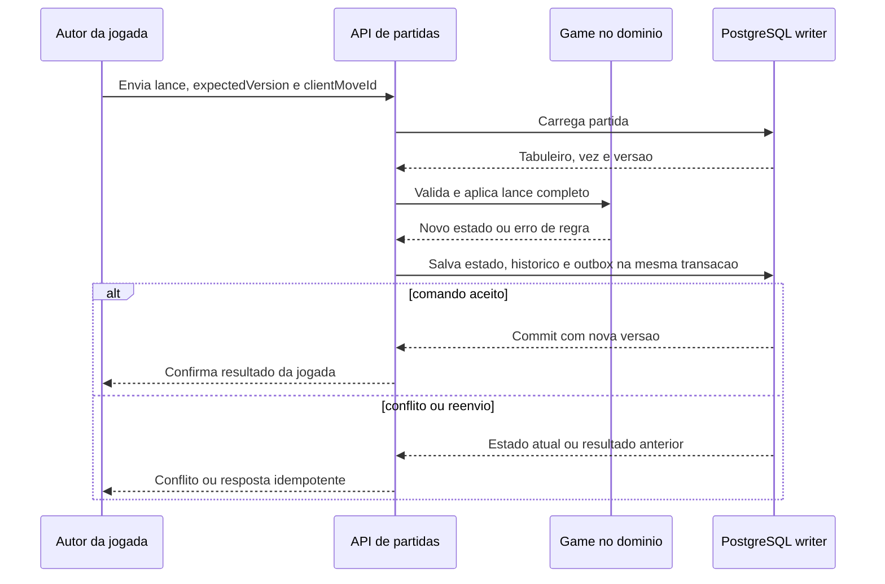
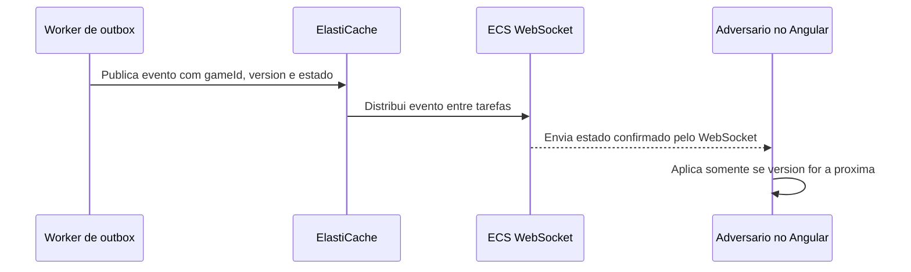

# Arquitetura da aplicação

> **Estado atual:** o MVP local implementa domínio, REST, PostgreSQL, Angular e WebSocket em uma instância. Terraform regional foi preparado, mas não aplicado. Autenticação real, outbox e distribuição entre instâncias continuam futuras. Veja [execução](../running.md) e [tempo real](../realtime.md). Os diagramas de worker/ElastiCache e arquitetura global abaixo são estudos de evolução.

## Componentes da aplicação

| Componente | Responsabilidade |
|---|---|
| Angular | Exibe tabuleiro, turno e versão; monta o lance completo e envia comando. Ao reconectar ou detectar lacuna de versão, consulta o estado atual. |
| API REST | Recebe comandos e devolve confirmação ou erro ao autor da jogada; identifica o usuário autenticado. `GET /games/{id}` fornece o estado oficial. |
| WebSocket | Entrega ao adversário o estado confirmado da partida para atualizar o tabuleiro sem novo GET. Não decide o turno nem garante histórico de eventos. |
| `game/application` | Coordena carregamento, autorização, chamada ao domínio e persistência transacional; define portas para dependências externas. |
| `game/domain` | `Game` valida um lance inteiro conforme as [regras brasileiras](../rules/README.md), atualiza tabuleiro e troca a vez. Independe de Spring e PostgreSQL. |
| `game/infrastructure` | Adapta banco e transporte às portas da aplicação; atualiza o estado condicionalmente por `expectedVersion`. |
| PostgreSQL | Fonte oficial de tabuleiro, jogador da vez, versão, histórico e `clientMoveId` único. Estado e histórico devem ser gravados na mesma transação. |

Os pacotes são organizados **por funcionalidade**: `game/domain`, `game/application` e `game/infrastructure`. `Player` forma outro agregado, referenciado por `PlayerId`. A versão detecta comandos enviados sobre um estado antigo; `clientMoveId` torna o reenvio idempotente. Veja o [modelo de domínio](domain-model.md).

## Sequência alvo de uma jogada (com outbox futura)

### Autor da jogada recebe a confirmação

O domínio valida o lance antes da tentativa de gravação. A transação só confirma se a versão do banco ainda for a esperada; uma disputa entre requisições pode gerar conflito mesmo após a validação do domínio. A outbox entra no mesmo commit **quando for implementada**. A resposta da API informa ao autor que o estado foi persistido; não significa que o adversário já recebeu o aviso.

### Adversário recebe o estado confirmado

Este segundo fluxo é **futuro**. A transação da jogada grava na outbox um evento com um **snapshot derivado do estado confirmado** (por exemplo, `gameId`, `version`, `board`, `currentPlayerId` e `status`). Depois do commit, o worker lê esse evento e o publica no ElastiCache; a tarefa que mantém o WebSocket entrega o snapshot ao adversário. **O WebSocket não chama a API a cada jogada**, e o worker não grava novamente a partida. O PostgreSQL continua sendo a fonte oficial.

O Angular aplica somente versões novas e consecutivas. Se receber uma versão repetida, ignora; se detectar uma lacuna ou reconectar, chama `GET /games/{id}` para recuperar o estado oficial. A aba do autor já recebeu o resultado da API; outras abas ou dispositivos podem receber o mesmo evento e aplicar a versão normalmente. Não incluir dados privados de outros jogadores no snapshot enviado à sala da partida.

## Componentes AWS e sua finalidade

Este é o **mapeamento planejado** dos componentes da aplicação para a implantação AWS. A [arquitetura alvo](aws-deployment.md) detalha a VPC; a [arquitetura global](aws-deployment-global.md) expande o desenho para contingência e grande escala.

| Componente AWS | Onde fica | Função no jogo |
|---|---|---|
| Route 53 | DNS global | Resolve `damas.highonline.com.br` para a distribuição CloudFront. |
| CloudFront | Borda global | CDN para os arquivos Angular; encaminha API e, futuramente, WebSocket à origem, sem cache para comandos ou estado privado. |
| AWS WAF | Associado ao CloudFront | Filtra requisições e aplica limites de taxa na borda; não substitui autenticação nem validação de jogadas. |
| S3 privado com OAC | Fora da VPC | Guarda o build estático do Angular acessível pela distribuição. |
| VPC e Internet Gateway | Região AWS | Delimitam a rede da aplicação e permitem entrada nas subnets públicas. |
| Subnets públicas e ALB | Pelo menos duas AZs | ALB recebe HTTPS/WSS e encaminha à tarefa ECS saudável; subnets públicas dão a rota de entrada. |
| Subnets privadas de aplicação e ECS Fargate | Pelo menos duas AZs | Executam o Spring Boot e, futuramente, o worker, sem IP público. Tarefas podem escalar, mas não são fonte oficial do estado. |
| Subnets privadas de dados e RDS PostgreSQL Multi-AZ | Região AWS | Persistem partida e histórico com disponibilidade entre AZs. O writer confirma as jogadas. |
| Security Groups | VPC | Limitam tráfego ao necessário entre ALB, ECS e banco. Restringir acesso direto ao ALB para não contornar o WAF da borda. |
| NAT Gateway ou VPC endpoints | Conforme a necessidade | Permitem saída controlada das tarefas privadas para dependências externas ou serviços AWS. |
| CloudWatch, IAM e Secrets Manager | Região AWS | Monitoramento, permissões mínimas e gestão de credenciais. |
| ElastiCache e worker de outbox | Etapa futura, subnets privadas | Distribuem o snapshot confirmado entre tarefas WebSocket; a outbox no banco permite retentar a publicação. ElastiCache não controla a vez. |

**RDS PostgreSQL Multi-AZ** é o alvo inicial de implantação. **Aurora PostgreSQL Global Database** pertence ao estudo de expansão entre regiões; trocar de banco exige análise de custo, carga, migração e recuperação. Nenhum desses serviços foi provisionado por este documento.

