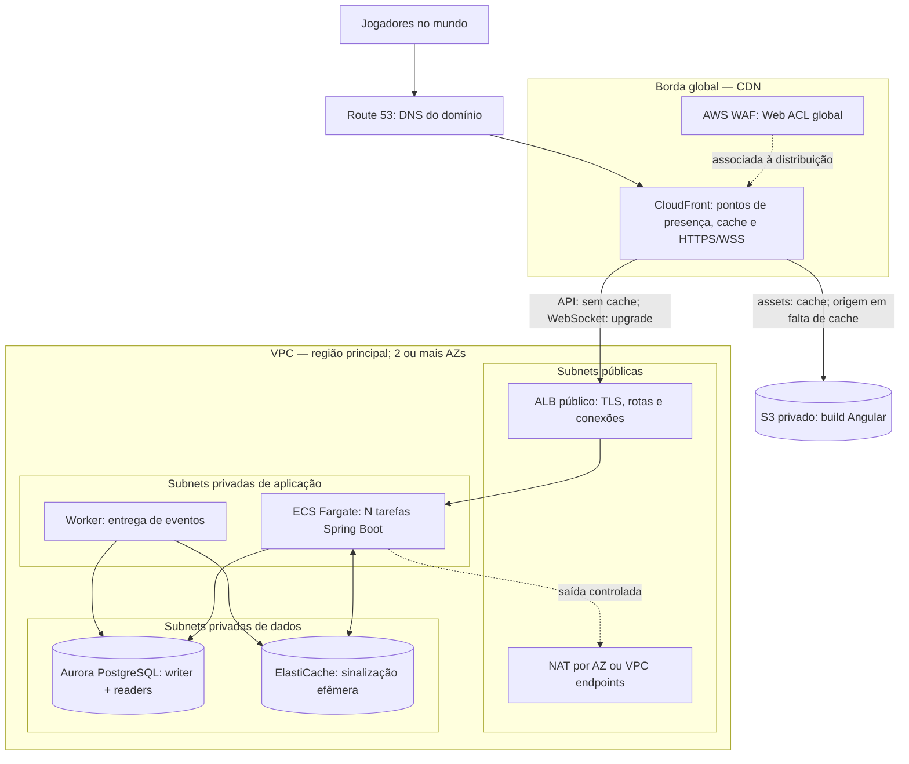
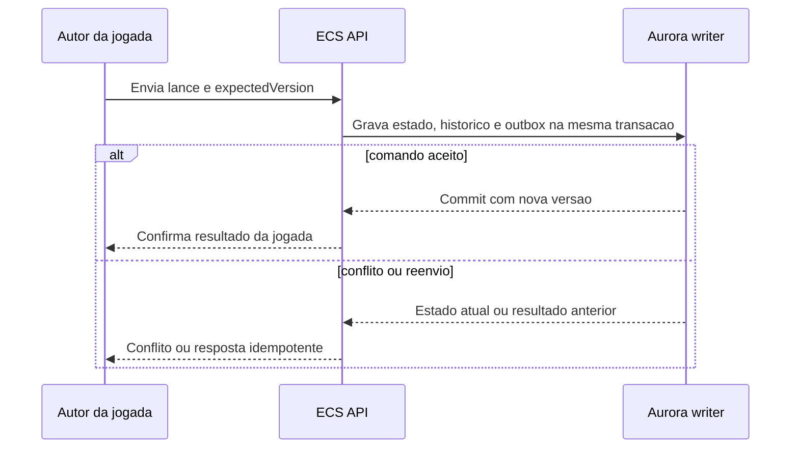
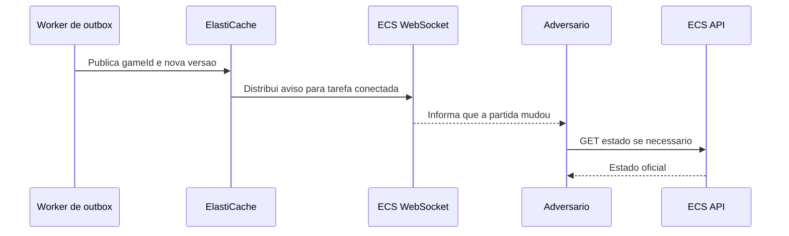
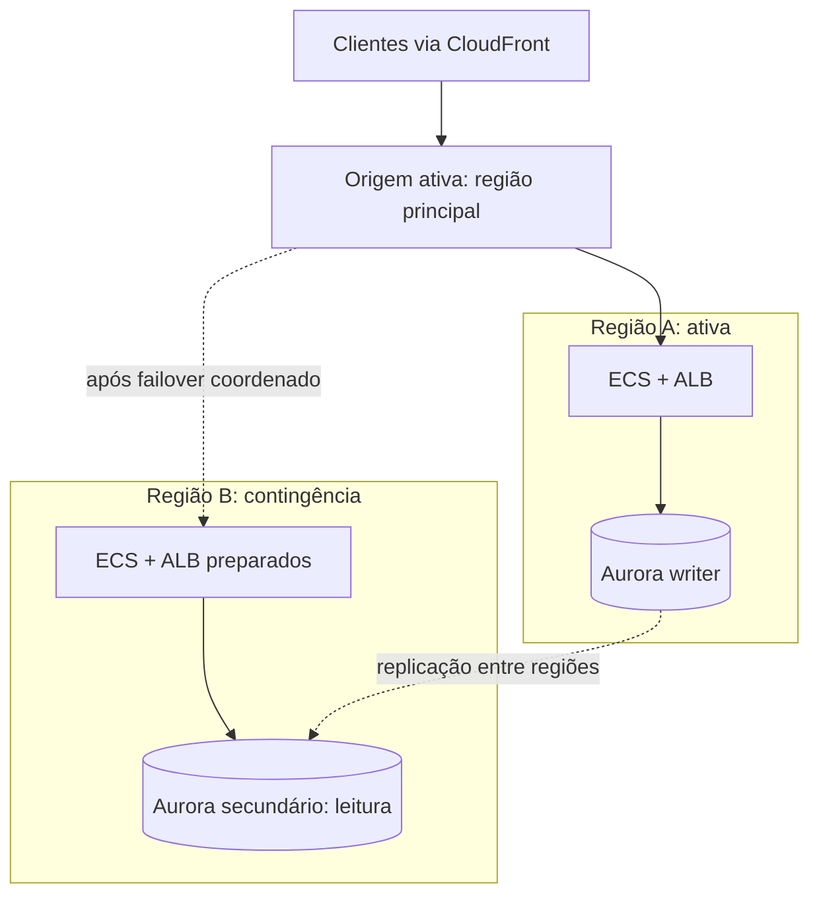

# Implantação AWS global — arquitetura de estudo

> **Proposta futura, não provisionada.** Cenário hipotético de milhões de usuários cadastrados. Capacidade real depende de usuários simultâneos, conexões WebSocket, partidas ativas, jogadas por segundo, tamanho das mensagens e regiões de origem. O projeto atual está no domínio do backend. Não aplicar este desenho de uma vez; medir e evoluir por etapas.

## 1. Borda global e rede

**Fluxo:** `damas.highonline.com.br` resolve para CloudFront; comportamentos distintos servem `/assets/*` do S3, e `/api/*` e `/ws/*` do ALB. Não fazer cache de respostas personalizadas nem de comandos de jogada. WebSocket atravessa CloudFront até o ALB com políticas de cabeçalhos e timeouts apropriadas. A caixa **Borda global — CDN** representa a rede de pontos de presença do CloudFront, não uma subnet ou um recurso adicional a contratar. O WAF é uma **associação à distribuição**, representada por linha pontilhada, não uma instância na VPC.

| Componente | Local | Função e atenção operacional |
|---|---|---|
| Route 53 | DNS global | Nome do jogo, registros para CloudFront; DNS não executa regras de segurança HTTP. |
| CloudFront | Borda global | TLS, cache do Angular e proxy dos caminhos dinâmicos. Reduz latência de **assets**, mas a jogada ainda precisa chegar à região que grava a partida. |
| AWS WAF Web ACL global | Associada ao CloudFront | Regras gerenciadas, bloqueios e limites de taxa para HTTP(S), inclusive a requisição de abertura do WebSocket. Não valida regras de damas nem substitui autenticação e limites por usuário dentro da aplicação. |
| S3 + Origin Access Control | Fora da VPC | Guarda os arquivos compilados do Angular com bucket privado; acesso pela distribuição. |
| VPC | Região AWS | Limite lógico da rede; CIDRs sem sobreposição e espaço para crescimento. |
| Subnets públicas, uma por AZ | VPC | Hospedam ALB com entrada pública e, se necessários, NAT Gateways. Internet Gateway e rotas dão acesso à Internet. |
| ALB | Subnets públicas | Recebe HTTPS/WSS do CloudFront, termina TLS conforme configuração e distribui conexões entre tarefas. Planejar health checks, conexões longas e proteção contra acesso direto ao origin. |
| Subnets privadas de aplicação | VPC | Tarefas ECS e worker sem IP público; NAT por AZ ou endpoints privados para dependências AWS conforme o acesso requerido. |
| ECS Fargate | Aplicação | Escala horizontalmente API e conexões WebSocket; tarefas são descartáveis, sem estado oficial de partidas em memória. Dimensionar CPU, memória, novas conexões e conexões abertas com testes de carga. |
| Subnets privadas de dados | VPC | Banco e Redis sem rota direta da Internet; acesso via Security Groups específicos. |
| Aurora PostgreSQL | Dados | Writer para transações de jogada; readers só para consultas que toleram defasagem. Estado oficial, versão, unicidade de `clientMoveId`, histórico e outbox ficam no banco. |
| ElastiCache | Dados | Distribui avisos entre tarefas com WebSocket e, se medido, mantém dados derivados de leitura. Nunca decide de quem é a vez. Pub/Sub sozinho não é armazenamento durável. |
| Worker de outbox | Aplicação | Lê eventos gravados na mesma transação da jogada e os envia aos canais de entrega; publicação repetida exige consumidores idempotentes. |
| Security Groups | VPC | Permitir apenas CloudFront/origem autorizada → ALB, ALB → ECS, ECS/worker → banco e Redis nas portas necessárias. Revisar também egress. |
| CloudWatch e tracing | Regional | Métricas de latência, erros, partidas e conexões; logs com correlação por partida e alarmes para saturação e atraso da réplica. Evitar dados sensíveis em logs. |
| Secrets Manager e IAM | Regional | Senhas e segredos fora do código; papéis separados para tarefa, execução e worker, com permissões mínimas. |

A implementação e as cotas dependem da carga medida. Planejar orçamento e alarmes antes de expandir Fargate, Aurora, WAF, tráfego CloudFront, transferência entre AZs e regiões e conexões de banco.

## 2. Consistência de uma partida

### Confirmação ao autor da jogada

O **Aurora writer confirma o commit à API**, que responde ao **autor da jogada**. Isso informa que o lance foi persistido; não significa que o adversário já atualizou sua tela.

### Aviso ao adversário

O worker lê **o evento já confirmado na outbox** e publica um aviso para alcançar a tarefa que mantém o WebSocket do adversário. O aviso pode levar apenas `gameId` e `version`; o cliente busca o estado quando necessário. Também é possível incluir um resumo da jogada, desde que se trate como **cópia derivada**. Outras abas ou dispositivos do autor da jogada também podem receber o aviso, mas a aba que enviou o lance já recebeu a resposta da API e deve ignorar eventos com a mesma versão. **Não há uma segunda gravação da jogada no banco.**

**O agregado `Game` valida o lance inteiro** conforme [regras brasileiras](../rules/README.md). Atualização condicional por `game.version` impede duas jogadas concorrentes sobre a mesma versão; `clientMoveId` único por partida protege reenvios. O histórico e a outbox entram na transação do estado. A entrega WebSocket pode atrasar, se perder ou duplicar; cada cliente compara versões e, ao reconectar, consulta `GET /games/{id}` na fonte oficial. A outbox reduz o risco de commit sem publicação, mas requer monitorar tentativas, atraso e repetição. Como Pub/Sub é efêmero, a sincronização após reconexão sempre usa o estado persistido.

Para escalar writes além de um writer, **medir primeiro**. Se necessário, particionar partidas por `gameId` entre bancos ou regiões proprietárias; cada partida permanece com **um único writer**. Isso exige roteamento, migração de partidas e estratégia de falha próprios — não é consequência automática de adicionar leitores ao Aurora.

## 3. Recuperação entre regiões

Aurora Global Database mantém **um cluster principal gravável** e secundários para leitura e recuperação. Em falha regional: verificar atraso de replicação e impacto, promover o cluster secundário seguindo o procedimento oficial, garantir que apenas a nova região aceite escritas, trocar a origem da API e testar leitura/jogada/reconexão. A replicação é assíncrona: RPO pode ser maior que zero; conexões WebSocket precisarão reconectar. Não presumir failover transparente, sem perda ou ativo-ativo de writes. Exercitar o procedimento e definir RTO/RPO explícitos antes de prometer disponibilidade global.

## 4. CloudFront, Cloudflare e posição do WAF

| Aspecto | CloudFront | Cloudflare |
|---|---|---|
| Produto no desenho | CDN/proxy de borda da AWS; integra S3, ALB e AWS WAF | Plataforma de borda de outro fornecedor; oferece CDN, DNS, proxy, WAF e proteção DDoS conforme configuração/plano |
| WAF | AWS WAF anexado ao CloudFront; opcionalmente uma Web ACL regional no ALB | WAF da Cloudflare no proxy, se o DNS estiver em modo proxied |
| DNS | Route 53 é serviço separado | DNS é parte da plataforma; registros podem ser DNS-only ou proxied |
| WebSocket | Suportado com política de encaminhamento adequada | Proxy de WebSocket suportado; conferir limites e preços do plano |
| Escolha para o estudo | Caminho coerente com Terraform e serviços AWS do projeto | Alternativa a avaliar se houver requisito concreto de recursos, preços ou operação da Cloudflare |

**Onde entra o WAF?** Para este desenho, associar uma Web ACL global **ao CloudFront**, antes da origem. Uma ACL regional adicional no ALB é opcional para proteção do origin, com regras e custo próprios. Não colocar um recurso WAF dentro da subnet. Proteger o ALB contra acesso direto é uma decisão separada: se aceitar conexões externas irrestritas, elas podem contornar o WAF da borda. Avaliar restrição de origem e compatibilidade com WebSocket no desenho final.

Usar Cloudflare como proxy na frente de CloudFront cria **duas camadas de CDN/proxy**, o que pode complicar cache, IP de origem, cabeçalhos, certificados, troubleshooting e cobrança. Para aprender AWS, começar por Route 53 + CloudFront + AWS WAF. Se usar Cloudflare somente para DNS, deixar o registro **DNS-only** ao apontar para outra CDN, conforme orientação da Cloudflare; então o tráfego HTTP continua protegido pelo WAF associado ao CloudFront.

## 5. Ordem sugerida para estudar

1. Domínio e concorrência otimista: concluir [issue #1](https://github.com/ralvesper/checkers-aws/issues/1) e [#2](https://github.com/ralvesper/checkers-aws/issues/2).
2. Medir perfil de carga: usuários simultâneos, WebSockets por tarefa, jogadas por segundo e taxa de cache.
3. VPC/subnets e custos com Terraform; depois CloudFront + WAF, ALB/ECS e banco.
4. Outbox, distribuição de avisos e reconexão.
5. Testes de carga, cotas, observabilidade e orçamento; só então região de contingência e ensaios de failover.

## Referências oficiais

- [AWS WAF: associação de Web ACL](https://docs.aws.amazon.com/waf/latest/developerguide/web-acl-associating-aws-resource.html)
- [AWS WAF: regras de taxa](https://docs.aws.amazon.com/waf/latest/developerguide/waf-rule-statement-type-rate-based-request-limiting.html)
- [CloudFront: WebSocket](https://docs.aws.amazon.com/AmazonCloudFront/latest/DeveloperGuide/distribution-working-with.websockets.html)
- [CloudFront: origem S3 privada](https://docs.aws.amazon.com/AmazonCloudFront/latest/DeveloperGuide/private-content-restricting-access-to-s3.html)
- [Aurora Global Database](https://docs.aws.amazon.com/AmazonRDS/latest/AuroraUserGuide/aurora-global-database.html)
- [Aurora Global Database: recuperação](https://docs.aws.amazon.com/AmazonRDS/latest/AuroraUserGuide/aurora-global-database-disaster-recovery.html)
- [Cloudflare: DNS proxied e outras CDNs](https://developers.cloudflare.com/dns/proxy-status/use-cases/)
- [Cloudflare: proxy WebSocket](https://developers.cloudflare.com/network/websockets/)
