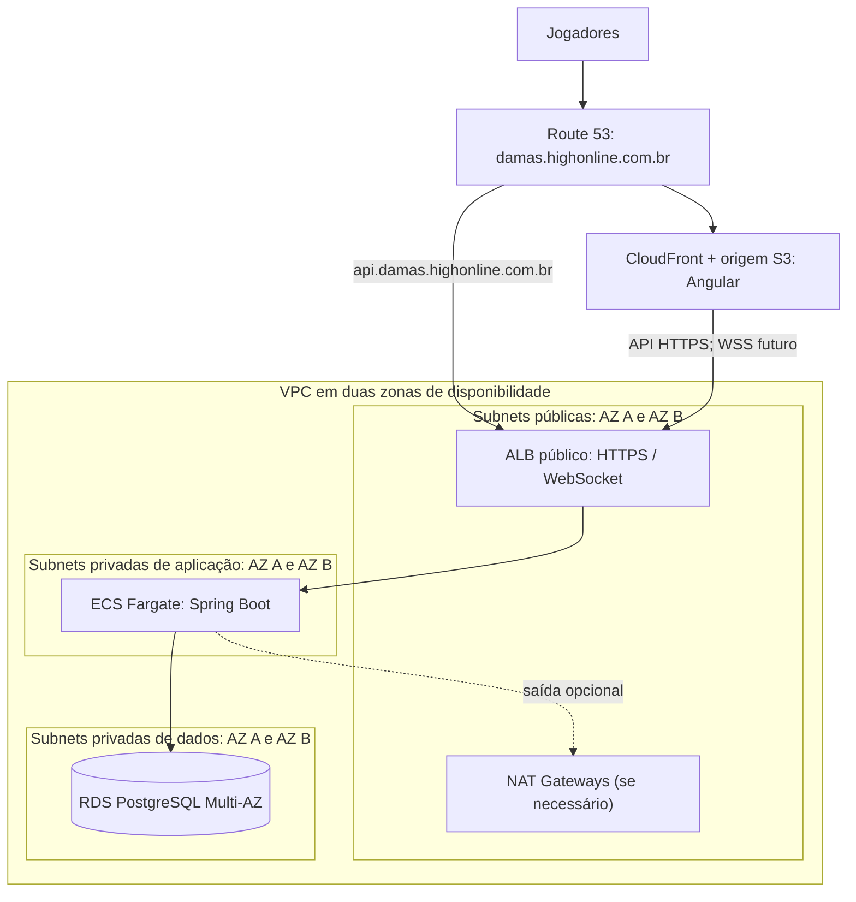

# Implantação AWS (arquitetura alvo)

Diagrama de referência para a evolução do projeto. Nenhum recurso AWS foi provisionado nesta etapa. Cada módulo Terraform será criado e revisado separadamente.

## Limites e ordem de implantação

- O frontend estático fica fora da VPC. O ALB é público; tarefas ECS e banco ficam em subnets privadas, sem IP público.
- Security Groups previstos: Internet → ALB (443), ALB → ECS (porta da aplicação), ECS → RDS (5432). Nenhum acesso direto da Internet ao banco.
- As duas zonas e RDS Multi-AZ são o desenho de disponibilidade desejado. NAT Gateways, ALB, RDS e Fargate têm custos recorrentes; revisar o `terraform plan` e a estimativa de custos antes de aplicar.
- Primeira etapa Terraform: VPC, subnets, tabelas de rotas e Internet Gateway, sem instâncias ou banco. As etapas seguintes adicionam execução, persistência e entrega do frontend.
- O PostgreSQL guarda o estado e a vez. Quando houver várias tarefas e WebSockets, avaliar um canal entre instâncias para distribuir avisos após o commit; não usar cache como autoridade do turno.
