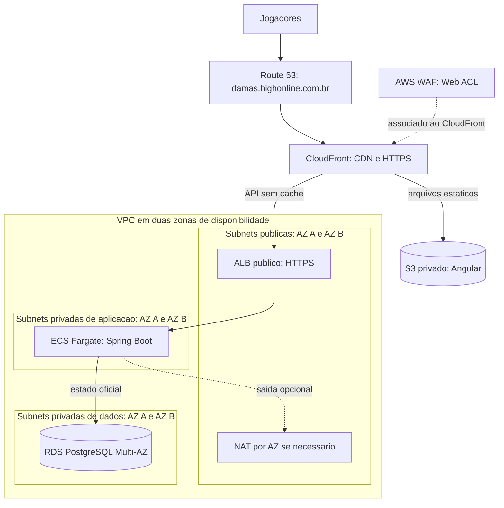

# Implantação AWS regional — primeira etapa

Este diagrama mostra a **base regional** para publicar Angular e a API Spring Boot. Nenhum recurso AWS foi provisionado por este documento. A implantação ocorrerá aos poucos com Terraform, depois de revisar plano e custos. O [desenho global e de tempo real](aws-deployment-global.md) documenta outbox, ElastiCache, WebSocket em múltiplas tarefas e recuperação entre regiões.

## Função dos componentes

| Componente | Finalidade |
|---|---|
| Route 53 | Resolve o domínio do jogo para CloudFront. |
| CloudFront e S3 privado | Entregam o build Angular pela CDN. A API dinâmica é encaminhada ao ALB sem cache do estado privado. |
| AWS WAF | Associado ao CloudFront para filtrar requisições e aplicar limites de taxa. É uma etapa de proteção da entrada pública, não um recurso dentro da VPC. |
| VPC, Internet Gateway e subnets públicas | Organizam a rede regional em duas AZs; o ALB recebe tráfego público pela rota de entrada. |
| ALB | Encaminha requisições HTTPS às tarefas ECS saudáveis. Proteger o acesso direto ao ALB para não contornar o WAF do CloudFront. |
| Subnets privadas de aplicação e ECS Fargate | Executam Spring Boot sem IP público. A API valida jogadas e confirma tabuleiro, vez, versão e histórico no banco. |
| Subnets privadas de dados e RDS PostgreSQL Multi-AZ | Guardam o estado oficial. O standby Multi-AZ atende recuperação, sem ser um segundo writer ativo da mesma partida. |
| Security Groups | Restringem ALB → ECS e ECS → RDS às portas necessárias. |
| NAT Gateway ou VPC endpoints | Oferecem saída às tarefas privadas somente quando necessária. |
| CloudWatch, IAM e Secrets Manager | Métricas e logs, permissões mínimas e credenciais da aplicação. |

## Ordem de implementação

1. Modelar VPC, subnets, rotas e Internet Gateway em Terraform; revisar `terraform plan` antes de `apply`.
2. Acrescentar frontend estático, ALB, ECS e RDS gradualmente. NAT Gateway, ALB, RDS e Fargate podem gerar custos recorrentes.
3. Acrescentar AWS WAF na entrada pública e verificar que a origem não pode ser acessada contornando a proteção.

Nesta etapa, o banco controla a vez. O cliente consulta a API para obter o estado atual. A entrega em tempo real entre várias tarefas ECS está descrita em [aws-deployment-global.md](aws-deployment-global.md); ela não faz parte deste diagrama simples.
