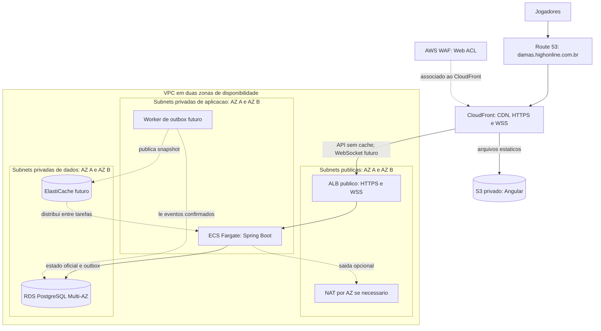

# Implantação AWS (arquitetura alvo)

Este documento mostra a implantação **regional** proposta para o jogo. Nenhum recurso AWS foi provisionado nesta etapa. O primeiro corte usa API e RDS PostgreSQL; WebSocket, outbox e ElastiCache são etapas futuras. Veja a [arquitetura da aplicação](application-architecture.md) para os fluxos e o [estudo global](aws-deployment-global.md) para expansão entre regiões.

## Função dos componentes

| Componente | Finalidade |
|---|---|
| Route 53 | Resolve o domínio do jogo para CloudFront. |
| CloudFront e S3 privado | Entregam o build Angular pela CDN. CloudFront encaminha comandos HTTP e conexões WebSocket à origem sem armazenar o estado privado da partida em cache. |
| AWS WAF | Filtra requisições na distribuição CloudFront; não fica dentro da VPC nem decide jogadas. |
| VPC e subnets públicas | Organizam a rede regional em duas AZs. O ALB público recebe a entrada; Internet Gateway e rotas atendem esse acesso. NAT só entra conforme a necessidade de saída das tarefas privadas. |
| ALB | Distribui HTTPS e conexões WebSocket entre tarefas ECS saudáveis. Planejar proteção contra acesso direto ao ALB para não contornar o WAF da borda. |
| Subnets privadas de aplicação e ECS Fargate | Executam Spring Boot sem IP público. A aplicação valida jogadas e confirma estado, versão e histórico em transação no banco. |
| Subnets privadas de dados e RDS PostgreSQL Multi-AZ | Mantêm o tabuleiro e a vez oficiais; o writer confirma jogadas. O standby Multi-AZ atende recuperação, não representa outro writer ativo para a mesma partida. |
| Worker de outbox e ElastiCache (futuros) | Após o commit, distribuem o **snapshot confirmado** à tarefa que mantém o WebSocket do adversário. Não gravam a partida novamente nem controlam o turno. |
| Security Groups | Limitam tráfego entre ALB, ECS, RDS e, futuramente, ElastiCache. |
| CloudWatch, IAM e Secrets Manager | Oferecem observabilidade, permissões mínimas e gestão de credenciais. |

## Ordem de implementação e consistência

1. Modelar VPC, subnets, tabelas de rotas e Internet Gateway em Terraform; revisar `terraform plan` e custos antes de `apply`.
2. Acrescentar frontend estático, ALB, ECS e RDS por etapas. NAT Gateway, ALB, RDS e Fargate têm custos recorrentes.
3. Quando houver clientes simultâneos, adicionar WebSocket. A API confirma ao **autor da jogada**; após o commit, outbox e ElastiCache distribuem o estado confirmado ao **adversário** sem novo GET a cada lance.
4. O cliente só aplica versões novas e consecutivas. Após reconexão ou lacuna de versão, consulta `GET /games/{id}` no estado persistido; Pub/Sub não é histórico durável.

O PostgreSQL continua sendo a fonte oficial da partida. As tarefas ECS e o cache podem falhar ou ser substituídos sem redefinir de quem é a vez.
