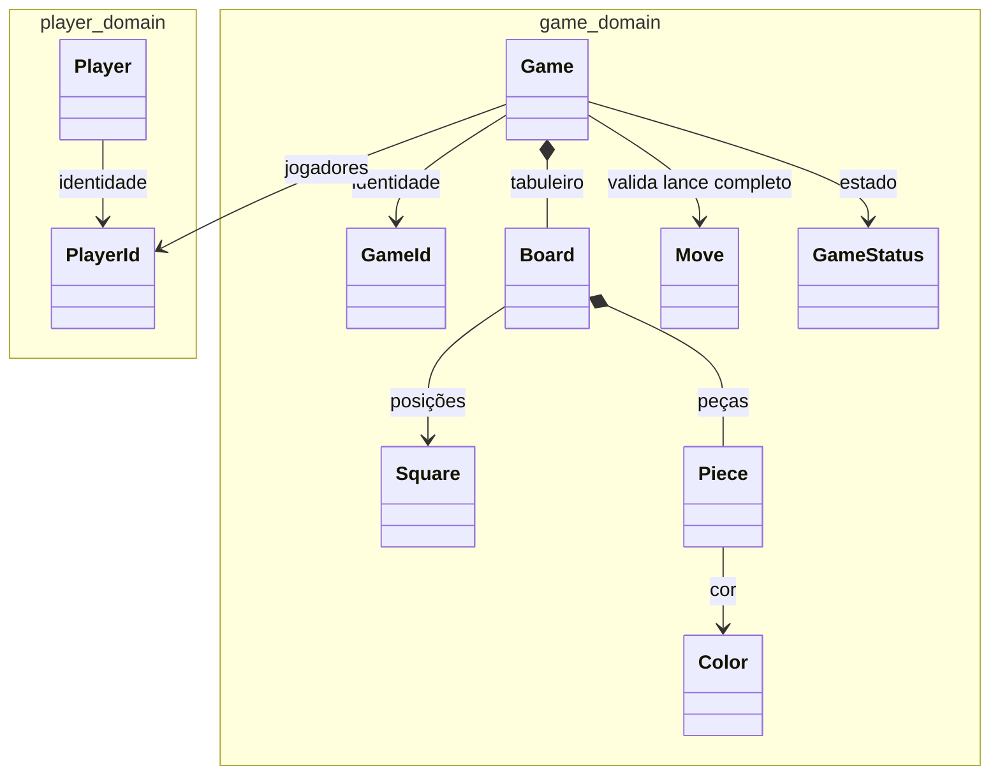

# Modelo de domínio atual

`Game` e `Player` são raízes de agregados separados. A partida referencia identidades de jogadores, sem carregar o agregado `Player`. `Board`, `Square`, `Piece`, `GameId` e `PlayerId` são value objects. `Move` representa um turno completo, inclusive capturas múltiplas. `Game.play` devolve um novo snapshot com tabuleiro, vez, versão, estado e vencedor. Lance inválido preserva o snapshot original.

