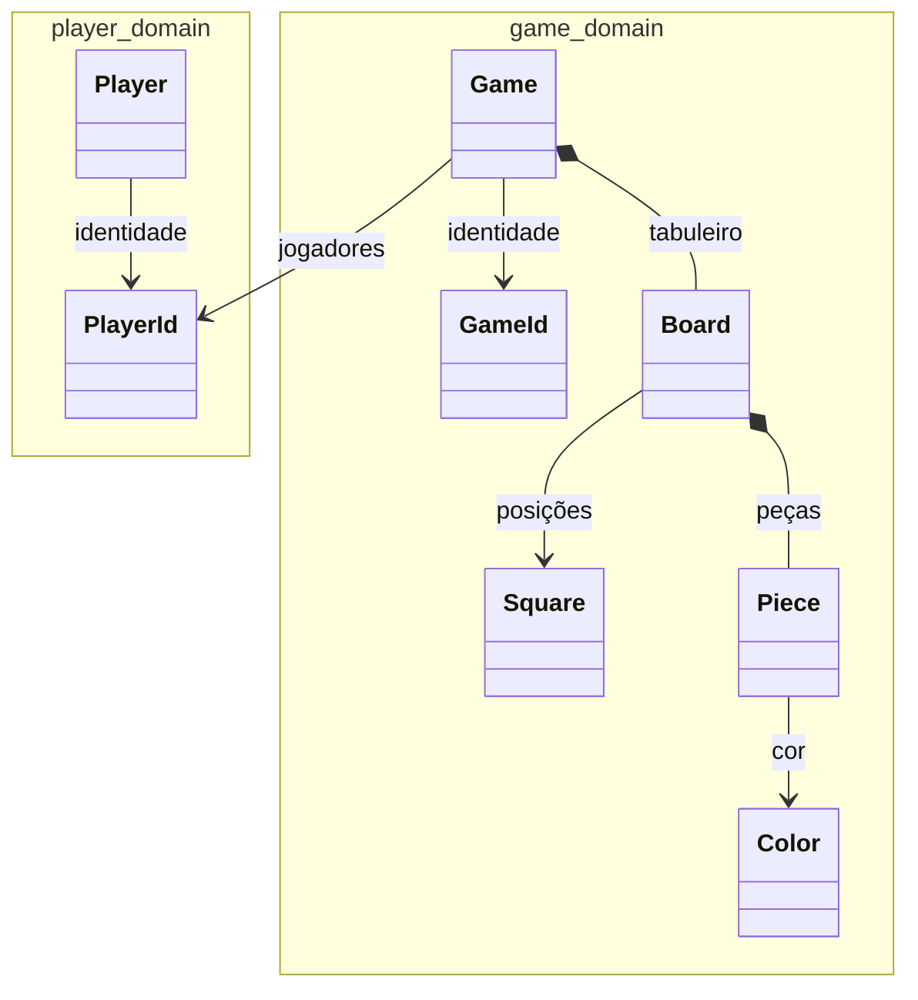

# Modelo de domínio atual

`Game` e `Player` são raízes de agregados separados. A partida referencia identidades de jogadores, sem carregar o agregado `Player`. `Board`, `Square`, `Piece`, `GameId` e `PlayerId` são value objects. O modelo ainda não contém jogadas nem transição de turnos.
