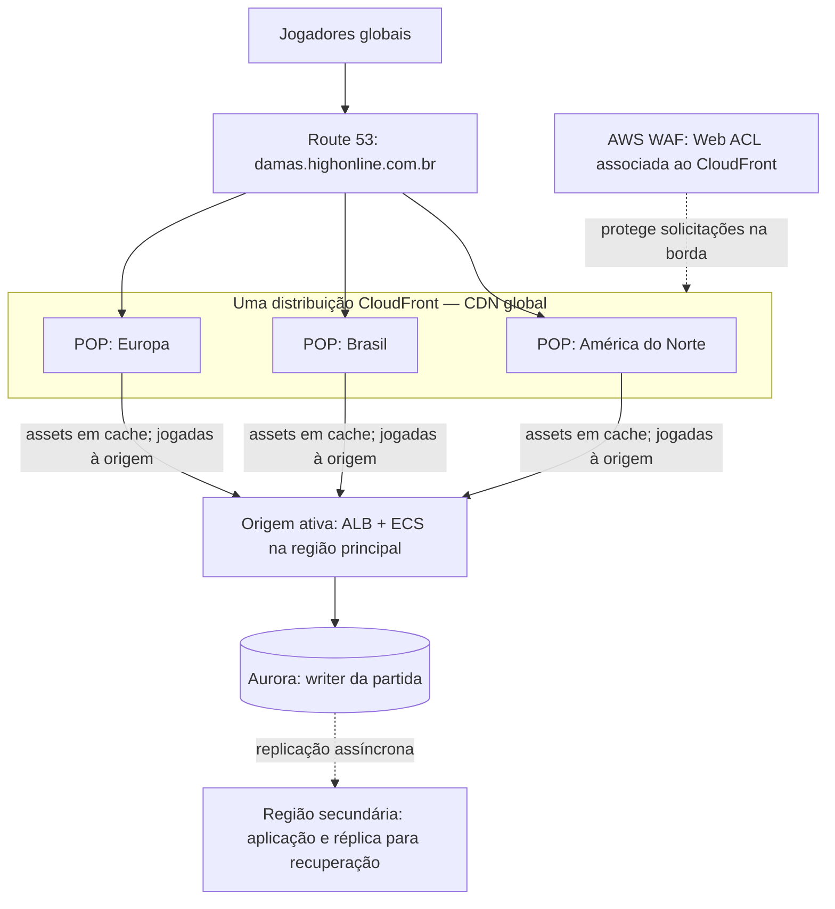
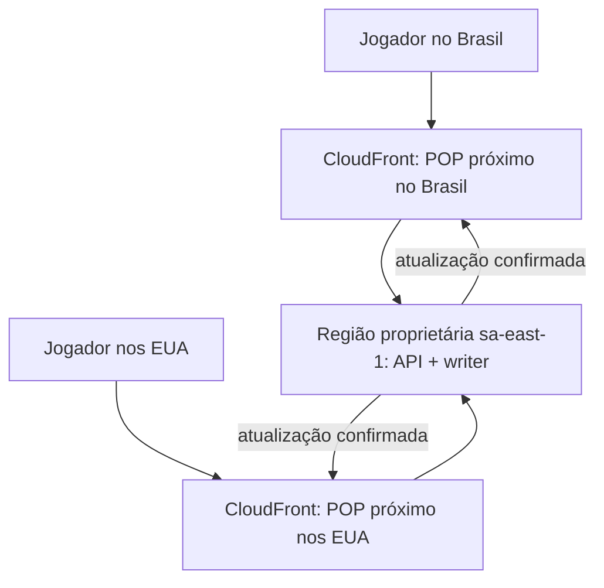

# Tráfego global — CDN e regiões da aplicação

Este diagrama é uma visão conceitual da [arquitetura AWS global](aws-deployment-global.md). Os três pontos de presença são **exemplos da rede global do CloudFront**, não três distribuições ou CDNs independentes. Um POP próximo atende arquivos Angular em cache; comandos de jogo seguem para a origem da aplicação. A localização efetiva dos POPs e o caminho escolhido são gerenciados pela CDN.

| Caixa | O que representa |
|---|---|
| Route 53 | Resolve o nome do jogo para a distribuição CloudFront; não escolhe um POP específico da figura. |
| Uma distribuição CloudFront | Configuração global de CDN com rede de pontos de presença. O frontend estático pode ser atendido do cache próximo ao jogador. |
| POPs América do Norte, Brasil e Europa | Presença ilustrativa da mesma CDN. **Não** são implantações em `us-east-1`, `sa-east-1` ou uma região europeia. |
| AWS WAF | Web ACL associada à distribuição global; a seta pontilhada mostra uma associação de proteção, não tráfego passando por uma VPC. |
| Origem ativa | Região AWS com ALB e tarefas ECS. API e WebSocket chegam aqui para processar jogadas. Ter cache perto do usuário não reduz, por si só, a latência da escrita nessa região. |
| Aurora writer | Autoridade do estado da partida: tabuleiro, vez e versão; somente uma região escreve neste desenho. |
| Região secundária | Contingência. A réplica não vira writer automaticamente só porque um POP próximo do usuário está nela. |

**Se a aplicação passar a operar em três regiões**, esse será outro desenho: cada região terá seus próprios ALB/ECS (e possivelmente dados), com roteamento e propriedade de partidas definidos. Direcionar o usuário ao servidor mais próximo sem considerar onde a partida é escrita pode aumentar a latência ou produzir leituras defasadas. Uma alternativa a estudar é associar cada `gameId` a uma região proprietária e manter ambos os jogadores dessa partida nela. Isso requer roteamento, reatribuição e recuperação explícitos.

## Exemplo: partida pertencente ao Brasil

Criar uma partida **a partir do Brasil não escolhe automaticamente a região brasileira**. Se adotarmos propriedade regional, o caso de uso de criação escolhe e grava `homeRegion = sa-east-1` junto ao `gameId`. O roteamento das próximas requisições precisa consultar ou carregar essa associação. A URL global e o POP próximo ao jogador, sozinhos, não descobrem a região proprietária.

| Situação | Caminho de uma jogada | Consequência |
|---|---|---|
| Dois jogadores nos EUA; partida atribuída a `us-east-1` | Cada jogador → POP próximo → API/writer nos EUA | Ambos acessam uma origem relativamente próxima. |
| Dois jogadores nos EUA; partida atribuída a `sa-east-1` | Cada jogador → POP próximo → API/writer no Brasil | Ambos percorrem a distância até o Brasil; a CDN não processa a jogada. |
| Um jogador no Brasil e outro nos EUA; partida atribuída a `sa-east-1` | Cada jogador → seu POP próximo → **a mesma** API/writer no Brasil | O jogador nos EUA pode perceber latência maior. O resultado volta pelo caminho de cada conexão. |
| Um jogador no Brasil e outro nos EUA; partida atribuída a `us-east-1` | Cada jogador → seu POP próximo → **a mesma** API/writer nos EUA | O jogador no Brasil pode perceber latência maior. |

Em qualquer caso, ambos observam uma única versão oficial da partida. O Angular e outros arquivos estáticos podem vir do cache próximo, mas comandos e atualizações WebSocket atravessam a rede até a região responsável. Para escolher a região na criação, estudar localização dos **dois** jogadores, latência medida, disponibilidade e regras de residência de dados; uma partida já iniciada não deve mudar de writer sem migração controlada. Se houver só uma região implantada, todas as partidas usam essa região, independentemente de onde o criador esteja.

O failover de *origem* nativo do CloudFront cobre solicitações GET/HEAD/OPTIONS, não o POST que envia uma jogada. Recuperação de escrita exige promover o banco e mudar o roteamento da API de maneira coordenada; não presumir failover automático do comando.

## Referências oficiais

- [Como o CloudFront entrega conteúdo](https://docs.aws.amazon.com/AmazonCloudFront/latest/DeveloperGuide/HowCloudFrontWorks.html)
- [Origem e políticas de encaminhamento do CloudFront](https://docs.aws.amazon.com/AmazonCloudFront/latest/DeveloperGuide/controlling-origin-requests.html)
- [Limites do failover de origem](https://docs.aws.amazon.com/AmazonCloudFront/latest/DeveloperGuide/high_availability_origin_failover.html)
- [Aurora Global Database](https://docs.aws.amazon.com/AmazonRDS/latest/AuroraUserGuide/aurora-global-database.html)
